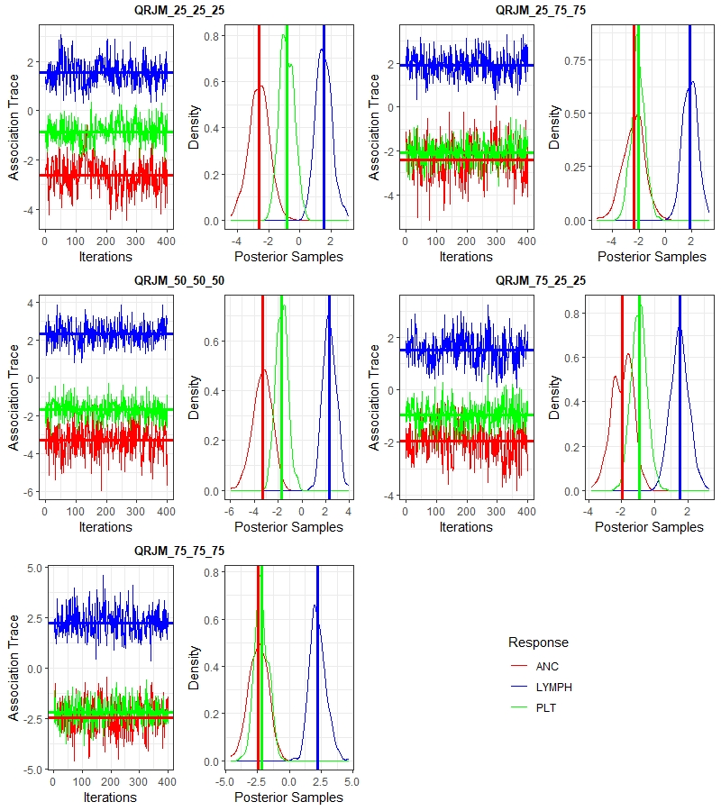

# Plots

Figures from the ALL maintenance data analysis in

> Kundu, D., Krishnan, S., Gogoi, M. P. and Das, K. (2024). A Bayesian quantile joint modeling of multivariate longitudinal and time-to-event data. *Lifetime Data Analysis*, 30(3), 680–699. https://doi.org/10.1007/s10985-024-09622-1

The figures are vector EPS files, which is the format the journal requires. GitHub does not preview EPS in the browser, so download a file to view it; `Trace.jpeg` is the only figure that displays here directly.

## Notation used in the figures

- **Biomarkers:** `LYMPH` = lymphocyte count, `ANC` = absolute neutrophil count, `PLT` = platelet count.
- **Quantile combinations:** a label such as `25_75_75` means the model was fitted at quantile levels τ = (0.25, 0.75, 0.75) for (LYMPH, ANC, PLT). The five combinations compared throughout are `25_25_25`, `25_75_75`, `50_50_50`, `75_25_25` and `75_75_75`.
- **Drugs:** `6MP` = 6-mercaptopurine, `MTX` = methotrexate.

## Exploratory data plots

| File | What it shows |
|---|---|
| `Sample_Trend.eps` | Mean lymphocyte, ANC and platelet counts over the weeks of maintenance therapy, on the original scale, split by relapse status. |
| `Contour.eps` | Bivariate density contours of subject-level mean ANC against mean platelet count, split by relapse status. Axes are marked at the empirical 10th, 25th, 50th, 75th and 90th percentiles. This motivates looking at different quantiles of each biomarker rather than only the mean. |
| `Quantile_Vs_tau.eps` | Empirical quantiles of the log-transformed LYMPH, ANC and PLT values plotted against the quantile level τ. |

## Model results across quantile combinations

| File | What it shows |
|---|---|
| `Association.eps` | Posterior estimates and 95% credible intervals of the association parameters ψ, linking each biomarker's quantile trajectory to the hazard of relapse, for each of the five quantile combinations. |
| `Medicine.eps` | Effects of 6MP and MTX on each biomarker (LYMPH, ANC and PLT panels) across the five quantile combinations, with 95% credible intervals. |
| `Med.eps` | The same drug effects as `Medicine.eps`, laid out by drug (6MP, MTX) with the biomarkers distinguished within each panel. |
| `Significance.eps` | Which baseline covariates are significant (95% credible interval excludes zero) in each longitudinal sub-model (LYMPH, ANC, PLT) and in the survival sub-model, for each quantile combination. |
| `Significance_Polarity.eps` | For the relapse-time sub-model, whether each baseline covariate's effect is significantly positive, significantly negative, or not significant, across the quantile combinations. |
| `Model_Overlap.eps` | Heatmap of the average percentage overlap of posterior 95% credible intervals between every pair of quantile combinations. Lower overlap means the two fits differ more, which shows that the choice of quantile levels changes the conclusions. |

Covariate labels in the significance plots: `Age`, `Gender`, `Lineage`, `Wbc_p` (presenting WBC), `NCI` (NCI risk), `Bulky`, `CNS`, `Risk_p` (risk at presentation), `Day8`, `M_CR1` (morphological CR1), `MRD`, `Day35`.

## MCMC diagnostics

| File | What it shows |
|---|---|
| `Trace_density.eps` | Trace plots and posterior densities of the association parameters ψ for LYMPH, ANC and PLT, one pair of panels for each of the five quantile combinations. Horizontal and vertical lines mark the posterior means. |
| `Trace.jpeg` | Raster copy of `Trace_density.eps`, shown below. |

Across all five quantile combinations the chains mix well. The lymphocyte association is positive, so higher lymphocyte counts go with a higher hazard of relapse. The ANC and platelet associations are negative, so higher counts go with a lower hazard.

## Reproducing the figures

- `Contour.eps` is produced by `Data_Viz.R`.
- The model-result and diagnostic figures are produced by `Visualization.R`, after `QRJM_main.R` has been run for each of the five quantile combinations.
- `Sample_Trend.eps` and `Quantile_Vs_tau.eps` are not generated by the scripts currently in this repository.

The patient-level data are confidential and not included, so the figures cannot be regenerated from this repository alone.
